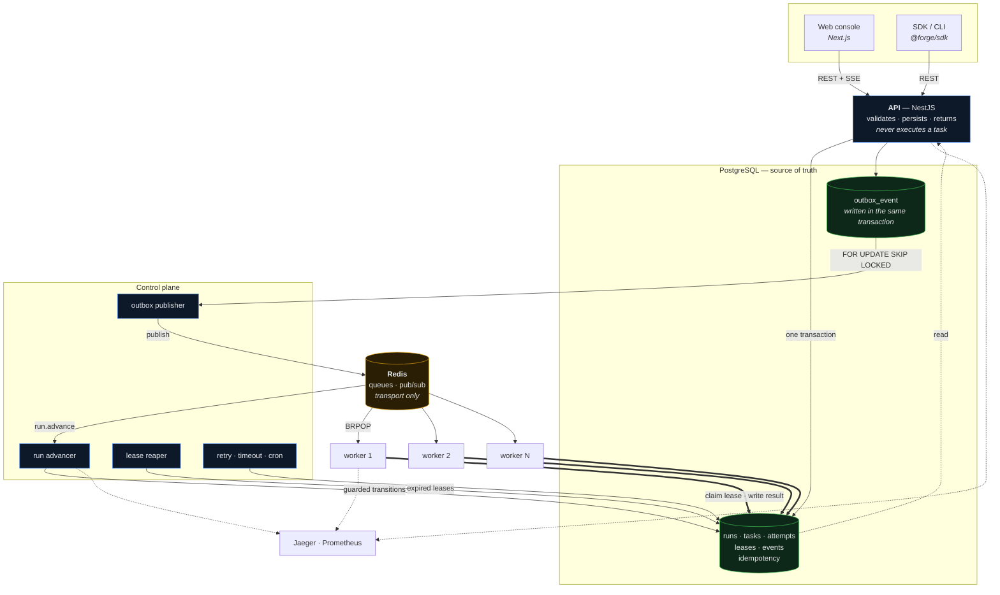

<div align="center">

# FORGE

### Distributed Workflow Orchestration Engine

**Distributed workflows. Built to survive failure.**

A self-hosted workflow orchestration engine with durable execution, worker leasing and a
transactional outbox — written to demonstrate how a system like this actually behaves
when parts of it die.

[Architecture](#architecture) · [Durability](#durable-execution) ·
[Run it](#local-development) · [Failure demo](#failure-recovery-demo) ·
[System design](docs/system-design.md) · [ADRs](docs/adr)

</div>

> **Screenshots** — none are committed. The console screens listed in
> [Screenshots](#screenshots) are reproducible in about two minutes by following
> [Local development](#local-development); every figure in them comes from PostgreSQL,
> so nothing there is mocked.

---

## Why FORGE exists

Most job queues answer "run this function later". That is a different problem from
"execute this graph of dependent tasks across a fleet, and still be correct after a
worker is `kill -9`'d mid-task".

The second problem is mostly about failure. A workflow engine is easy to build if nothing
ever crashes; every interesting decision in FORGE exists because something does. The
questions that shaped it:

- What happens to a task whose worker vanishes without reporting?
- What happens when a transaction commits and the process dies before publishing?
- What happens when the same message is delivered twice?
- What happens when someone edits a workflow while a run is halfway through it?
- What does the system do when Redis is wiped?

FORGE answers each of those with a mechanism rather than a hope, and the mechanisms are
tested — including an automated chaos demonstration that kills a real worker mid-task and
asserts that the run still completes.

## Features

**Execution**

- Workflows as DAGs, with fan-out, fan-in, and conditional branch pruning
- Distributed workers with per-node queue routing
- Configurable exponential backoff with full jitter, and non-retryable error codes
- Per-attempt and per-run timeouts
- Cooperative cancellation
- Immutable, content-addressed workflow versions

**Durability**

- PostgreSQL is the only source of truth; Redis is transport
- Transactional outbox for every state-change side effect
- Time-bounded worker leases with automatic recovery
- Append-only execution event log with a gap-free per-run sequence
- Idempotent run creation, safe under concurrency

**Operations**

- Live DAG visualisation over SSE, with per-node input, output, worker and attempt history
- Dead-letter queue with full attempt history, retry and acknowledge
- Worker fleet view with real-time task allocation
- Durable cron and one-shot schedules
- OpenTelemetry traces spanning API → outbox → queue → worker
- Prometheus metrics, structured logs, health and readiness endpoints

**Interfaces**

- REST API, type-safe TypeScript SDK, `forge` CLI, and a web console with a DAG editor

---

## Architecture



The thick arrows are the ones that matter. Workers read and write execution state
**directly in PostgreSQL**, under a lease. Redis only ever says "there may be work" — it
is never asked what the state is. That is why losing Redis costs latency, not correctness.

---

## Durable execution

Once a run begins, enough state is persisted that the system recovers from any process
dying at any point.

**A run is fully materialised at creation.** The run, every task, the first event and the
outbox intent are written in one transaction. There is no window where a run exists
without its tasks, and no lazy expansion that a crash could leave half-finished.

**Every transition is guarded.** State updates carry `WHERE state = <expected>`. A zero
row count means another writer won — normal under concurrency, and why plans are
recomputed rather than replayed. The legal transitions live in one explicit table, and
`RUNTIME_TASK_TRANSITIONS` declares every transition the system actually performs so a
test can assert the two agree. That guard exists because two real bugs shipped where a
call site performed a transition the table forbade.

**The scheduler is a pure function.** `advanceRun(graph, run, tasks) → plan` has no I/O.
The whole orchestration policy — fan-out, fan-in, conditional pruning, failure
propagation, completion — is 190 unit tests that need no database.

## Worker leasing

Every task attempt is held by a time-bounded lease that its holder must renew.

```
worker claims task ──▶ lease(expiresAt = now + 15s)
     │
     ├── renews every 5s  ← must be ≤ ⅓ of the TTL, validated at boot
     │
     ├── kill -9
     │
     ▼
lease expires ──▶ reaper marks attempt ABANDONED ──▶ task → QUEUED ──▶ another worker
```

The subtle part: **a lease expiry does not consume the retry budget.**

| Column       | Meaning                                        |
| ------------ | ---------------------------------------------- |
| `attempts`   | physical attempts started                      |
| `failures`   | attempts that failed for _application_ reasons |
| `recoveries` | attempts reclaimed after a lease expired       |

The retry policy is evaluated against `failures`. If it used `attempts`, a node with
`maxAttempts: 3` on a cluster that rescheduled its pod twice would dead-letter without the
application ever having failed. The user asked for "retry three times if it fails", not
"give up if Kubernetes moves you". → [ADR 004](docs/adr/004-worker-leases.md)

## Transactional outbox

The bug this prevents:

```ts
await prisma.taskRun.update({ ... });   // commits
await redis.lpush(queue, message);      // ← process dies here
// task is QUEUED forever; nothing will ever deliver it
```

Instead, the intent is written in the same transaction, and a publisher moves it:

1. claim a batch with `FOR UPDATE SKIP LOCKED` — no write yet
2. push to Redis
3. mark `PUBLISHED` and commit

Marking first would drop every message whose push failed. This way a crash between (2)
and (3) republishes — a duplicate, which consumers already tolerate. Duplicate delivery is
absorbable; a lost dispatch is a stuck workflow. → [ADR 003](docs/adr/003-transactional-outbox.md)

## Retry model

```
attempt 1 → immediate
attempt 2 → 1s   ├─ full jitter: uniform in [0, delay]
attempt 3 → 2s   ├─ so a fan-out failing together does not
attempt 4 → 4s   │  re-synchronise into a second stampede
   …             └─ clamped at maxDelayMs
```

Configurable per node: `maxAttempts`, `initialDelayMs`, `maxDelayMs`, `multiplier`,
`jitter`, and `nonRetryableErrors` for deterministic failures that retrying cannot fix.
Every attempt is a row; the console shows each one individually, including `ABANDONED`
ones.

## Delivery semantics

FORGE does **not** claim exactly-once. Three separate things, stated separately:

|                        | Guarantee                                                       |
| ---------------------- | --------------------------------------------------------------- |
| **Transport delivery** | at-least-once — duplicates are normal                           |
| **Task attempt**       | at-most-once **commit**, enforced by two unique constraints     |
| **Logical execution**  | at-least-once — retries and recovery are re-execution by design |
| **Run creation**       | exactly-once per idempotency key                                |

A handler may run more than once. What cannot happen is two runs both committing a
result. **If your handler has side effects, make it idempotent** — FORGE gives you
`$.node.attempt` and a natural key in the run id + node key.
→ [ADR 005](docs/adr/005-delivery-semantics.md)

## Observability

One workflow run is **one trace**, spanning five processes:

```
POST /v1/workflows/:key/runs   (api)
  └─ outbox.publish            (control plane)
       └─ run.advance          (control plane)
            └─ task.execute    (worker, another host, seconds later)
```

The W3C `traceparent` is serialised into the outbox payload and the queue message, then
re-extracted by the consumer. A trace that stops at the queue boundary answers half the
question.

Metrics come from real code paths — `forge_tasks_started_total`,
`forge_task_duration_seconds`, `forge_worker_lease_recoveries_total`,
`forge_dead_letters_total`. Fleet-wide gauges (`forge_queue_depth`,
`forge_active_workers`, `forge_outbox_lag_seconds`) are read from PostgreSQL at scrape
time, not accumulated per-process, so three API replicas do not each report a third of
the truth. → [ADR 006](docs/adr/006-observability.md)

---

## Local development

**Requirements:** Node ≥ 20.11, pnpm ≥ 10, Docker.

```bash
pnpm install
pnpm forge:dev
```

That starts PostgreSQL, Redis and Jaeger in containers, applies migrations, and runs the
API, control plane, **three workers** and the console with live reload — all output
interleaved into one stream, because the interesting moments in a distributed system span
two processes.

```bash
pnpm demo:seed          # install demo workflows + backfilled history
pnpm demo:run           # trigger a run and stream its timeline
```

|         |                               |
| ------- | ----------------------------- |
| Console | http://localhost:3000         |
| API     | http://localhost:4000         |
| Traces  | http://localhost:16686        |
| Metrics | http://localhost:4000/metrics |

### Everything in Docker

```bash
pnpm forge:up      # builds and runs the whole stack, 3 worker replicas
pnpm forge:logs
pnpm forge:down
```

### Ports

PostgreSQL is on **5435** and Redis on **6381**, deliberately offset from the defaults so
this stack runs alongside an existing local install without a fight.

---

## Failure recovery demo

The flagship demonstration. It kills a real worker mid-task and asserts, step by step,
that the run still completes:

```bash
pnpm demo:chaos
```

```
1. Check the platform is healthy
   ✓ 3 workers online

2. Trigger the crash-recovery workflow
   run f8cd7c31-7899-4c92-b4f8-073950161c0a (crash-recovery-demo v2)

3. Wait for a worker to claim the task that will crash
   ✓ worker f91bcbf4 claimed crash-step (attempt 1)

4. Wait for the lease to expire and the control plane to reclaim the task
   ✓ lease expired: lease for crash-step attempt 1 expired (worker f91bcbf4)
   ✓ task recovered: crash-step returned to the queue for another worker

5. Wait for a different worker to pick the task up
   ✓ worker 9db0c6d4 took over on attempt 2

6. Wait for the run to complete
   ✓ run SUCCEEDED in 22310ms, despite losing a worker mid-task

7. Verify the attempt history records what actually happened
   ✓ 2 attempts recorded: #1 ABANDONED, #2 SUCCEEDED
```

No human intervenes. The `simulate.crash` handler sends itself `SIGKILL` — no shutdown
hook, no lease release, no final heartbeat. Every step is asserted and the script exits
non-zero if any of them does not happen, so it works as a CI gate rather than a demo.

Other failure modes, all real:

```bash
pnpm demo:run resilience-demo   # retries with visible backoff, then a dead letter
```

---

## CLI

```bash
forge workflows list
forge workflows inspect order-fulfilment
forge run order-fulfilment '{"orderId":"ord_1","amount":4999}' --watch
forge runs list --state FAILED
forge runs inspect <runId> --timeline --io
forge runs cancel <runId>
forge workers
forge dead-letters list
forge dead-letters inspect <id>
forge dead-letters retry <id>
forge schedules list
forge system status
forge system stats
```

`--json` on any command emits machine-readable output and nothing else, so
`forge runs list --json | jq` works. Exit codes are part of the contract: `0` success,
`1` the command ran but the outcome was a failure, `2` usage error, `3` the API was
unreachable. `forge system status` exiting non-zero when degraded makes it usable as a CI
gate.

## SDK

```ts
import { ForgeClient, defineWorkflow } from '@forge/sdk';

const forge = new ForgeClient({ baseUrl: 'http://localhost:4000' });

// Define a workflow — dependency and reference mistakes are caught at the call site.
const workflow = defineWorkflow('order-fulfilment', 'Order Fulfilment')
  .task('validate', 'validate', { config: { required: ['orderId'] } })
  .task('reserve', 'delay', { after: 'validate' })
  .task('charge', 'http.echo', {
    after: 'validate',
    retry: { maxAttempts: 4, nonRetryableErrors: ['HTTP_402'] },
  })
  .task('ship', 'noop', { after: ['reserve', 'charge'] })
  .output({ shipped: '$.tasks.ship.output' })
  .build();

await forge.workflows.create(workflow);

// Trigger and await completion.
const run = await forge.runs.triggerAndWait('order-fulfilment', {
  orderId: 'ord_1',
  amount: 4999,
});
console.log(run.state, run.output);

// Or stream events live; reconnects and resumes from the last sequence number.
const stop = forge.streamRun(run.id, {
  onEvent: (e) => console.log(e.type, e.nodeKey, e.message),
});
```

The builder refuses a task that reads `$.tasks.x.output` without depending on `x` — that
is a race, not a style preference, and the server rejects it too.

## API

| Method | Path                               | Purpose                                      |
| ------ | ---------------------------------- | -------------------------------------------- |
| `GET`  | `/v1/workflows`                    | List definitions with run statistics         |
| `POST` | `/v1/workflows`                    | Create or update — idempotent by content     |
| `POST` | `/v1/workflows/validate`           | Validate without saving (used by the editor) |
| `GET`  | `/v1/workflows/:key`               | Definition, version and graph analysis       |
| `GET`  | `/v1/workflows/:key/versions`      | Version history                              |
| `POST` | `/v1/workflows/:key/runs`          | Trigger a run — accepts `Idempotency-Key`    |
| `GET`  | `/v1/runs`                         | Keyset-paginated run list                    |
| `GET`  | `/v1/runs/:id`                     | Run with tasks, definition and counts        |
| `GET`  | `/v1/runs/:id/events`              | Event history — `?afterSeq=` to resume       |
| `GET`  | `/v1/runs/:id/stream`              | **SSE** live event stream                    |
| `POST` | `/v1/runs/:id/cancel`              | Request cancellation (202 — cooperative)     |
| `POST` | `/v1/runs/:id/replay`              | Replay as a new run                          |
| `GET`  | `/v1/tasks/:id/attempts`           | Full attempt history                         |
| `GET`  | `/v1/workers`                      | Fleet with current allocation                |
| `GET`  | `/v1/dead-letters`                 | Dead letters with attempt history            |
| `POST` | `/v1/dead-letters/:id/retry`       | Requeue in place                             |
| `POST` | `/v1/dead-letters/:id/acknowledge` | Resolve without retrying                     |
| `GET`  | `/v1/schedules`                    | Durable schedules                            |
| `GET`  | `/v1/system/status`                | Component health                             |
| `GET`  | `/v1/system/stats`                 | Dashboard aggregate                          |
| `GET`  | `/health` · `/health/ready`        | Liveness · readiness                         |
| `GET`  | `/metrics`                         | Prometheus                                   |

Liveness and readiness are separate deliberately: probing dependencies in a liveness check
turns a brief database blip into a restart loop that makes the outage permanent.

---

## Testing

```bash
pnpm test               # 370 unit tests — no infrastructure required
pnpm test:setup         # create the isolated integration database
pnpm test:integration   # against real PostgreSQL and Redis
pnpm lint && pnpm typecheck
```

| Suite                                      | What it covers                                                                                                                                                                          |
| ------------------------------------------ | --------------------------------------------------------------------------------------------------------------------------------------------------------------------------------------- |
| `packages/engine` (190)                    | DAG validation, cycle detection, fan-out/fan-in, conditions, failure propagation, retry maths, lease arithmetic, expression parser including injection and prototype-pollution attempts |
| `packages/engine/test/transition-coverage` | Every transition the runtime performs is legal — the guard against the class of bug described above                                                                                     |
| `apps/api` (17)                            | Input validation at the trust boundary: hostile keys, oversized payloads, identifier abuse                                                                                              |
| `packages/contracts` (39)                  | The workflow schema itself — the trust boundary every submitted definition crosses                                                                                                      |
| `packages/config` (14)                     | Fail-fast environment validation, including the lease/heartbeat invariant                                                                                                               |
| `packages/logger` (11)                     | Secret redaction paths                                                                                                                                                                  |
| `packages/observability` (11)              | Metric names, bounded label cardinality, scrape-time gauges                                                                                                                             |
| `packages/sdk` (16)                        | Workflow builder validation                                                                                                                                                             |
| `apps/worker` (21)                         | Handler registry gating and the built-in handlers                                                                                                                                       |
| `apps/scheduler` (12)                      | The supervised control-plane loop: backoff, recovery, graceful stop                                                                                                                     |
| `apps/cli` (18)                            | Table rendering, including ANSI-safe column widths                                                                                                                                      |
| `apps/web` (21)                            | Console formatting                                                                                                                                                                      |
| `apps/scheduler` integration (13)          | Real PostgreSQL + Redis: claim races, lease loss, crash recovery, retry→dead-letter, failure propagation, concurrent idempotency, outbox republish                                      |

Integration tests use their own database and Redis index. They assert on exact state
("this task is QUEUED and nothing has claimed it"), which a running `pnpm forge:dev`
would invalidate within milliseconds — and the isolation means both can run at once.

**Three real bugs were found by these tests during development**, all of the same shape:
a component performed a state transition the state machine forbade. They are described in
`transition-coverage.test.ts`, which now makes that class of bug fail the build.

---

## Project structure

```
forge/
├── apps/
│   ├── api/          NestJS — definitions, run commands, queries, SSE
│   ├── worker/       leases tasks, executes handlers, reports outcomes
│   ├── scheduler/    control plane: publisher, advancer, reaper, sweepers, cron
│   ├── web/          Next.js console — DAG editor, live execution, fleet, DLQ
│   └── cli/          the `forge` command
├── packages/
│   ├── engine/       ★ pure orchestration: DAG, state machine, retry, expressions
│   ├── contracts/    Zod schemas + view models shared by every runtime
│   ├── database/     Prisma schema and data access
│   ├── transport/    Redis queues and pub/sub
│   ├── sdk/          typed client + workflow builder
│   ├── observability/ OpenTelemetry + Prometheus
│   ├── config/       fail-fast environment validation
│   ├── logger/       structured logging with redaction
│   └── testing/      shared fixtures
├── infra/
│   ├── docker/       multi-stage Dockerfile + compose
│   ├── kubernetes/   manifests, and an honest note on what production would need
│   └── otel/         Prometheus scrape config
├── docs/
│   ├── system-design.md
│   ├── adr/          seven architecture decision records
│   └── portfolio-entry.md
├── examples/         workflow definitions and SDK usage
└── scripts/          dev orchestration, seed, demo, chaos
```

`packages/engine` is where the interesting code is. It has no I/O at all.

## Screenshots

Reproduce in ~2 minutes with `pnpm forge:dev && pnpm demo:seed`:

1. **Live execution** — `/console/runs/:id` — DAG updating over SSE, timeline, task detail
2. **Workflow editor** — `/console/workflows/new` — validation against the real engine
3. **Dead letters** — `/console/dead-letters` — full attempt history per entry
4. **Worker fleet** — `/console/workers` — per-worker slot allocation
5. **Overview** — `/console` — throughput, success rate, outbox lag
6. **Retry sequence** — run `resilience-demo`, watch the backoff in the timeline

## Technical decisions

Each has an ADR explaining context, alternatives and consequences:

|                                                   |                                                 |
| ------------------------------------------------- | ----------------------------------------------- |
| [001](docs/adr/001-postgresql-source-of-truth.md) | PostgreSQL as the single source of truth        |
| [002](docs/adr/002-redis-as-transport.md)         | Redis as transport, never as state              |
| [003](docs/adr/003-transactional-outbox.md)       | Transactional outbox                            |
| [004](docs/adr/004-worker-leases.md)              | Worker leases, and the retry-budget distinction |
| [005](docs/adr/005-delivery-semantics.md)         | What FORGE actually guarantees                  |
| [006](docs/adr/006-observability.md)              | One trace across five processes                 |
| [007](docs/adr/007-safe-condition-expressions.md) | A purpose-built expression language             |

## Trade-offs

- **PostgreSQL as the source of truth** caps throughput and buys correctness that is
  simple to reason about. Wrong for a million tasks a second; right here.
- **The outbox** costs ~250ms of dispatch latency and buys the guarantee that no state
  change loses its side effect.
- **Leases** cost recovery latency bounded by the TTL and buy automatic recovery with no
  human in the loop.
- **A pure engine** costs a layer of indirection and buys an orchestration policy that is
  exhaustively testable without infrastructure.
- **A bespoke expression language** costs expressiveness and removes a code-execution
  surface entirely.

## Future improvements

Ordered by how much they would matter:

1. **Dynamic fan-out** — one task per item in a runtime collection. The most significant
   missing feature; requires the task set to grow during a run.
2. **Sub-workflows** — invoking a workflow as a node.
3. **PgBouncer** — every worker replica holds connections; this is the first thing to hit.
4. **Partitioning** `execution_event` and `task_attempt` by month.
5. **Cross-run concurrency limits** — mutexes and semaphores across runs.
6. **A real identity provider** in front of the API and console.
7. **Signals and waits** — a task that blocks until an external event arrives.

## Contributing

See [CONTRIBUTING.md](CONTRIBUTING.md).

## License

MIT — see [LICENSE](LICENSE).
